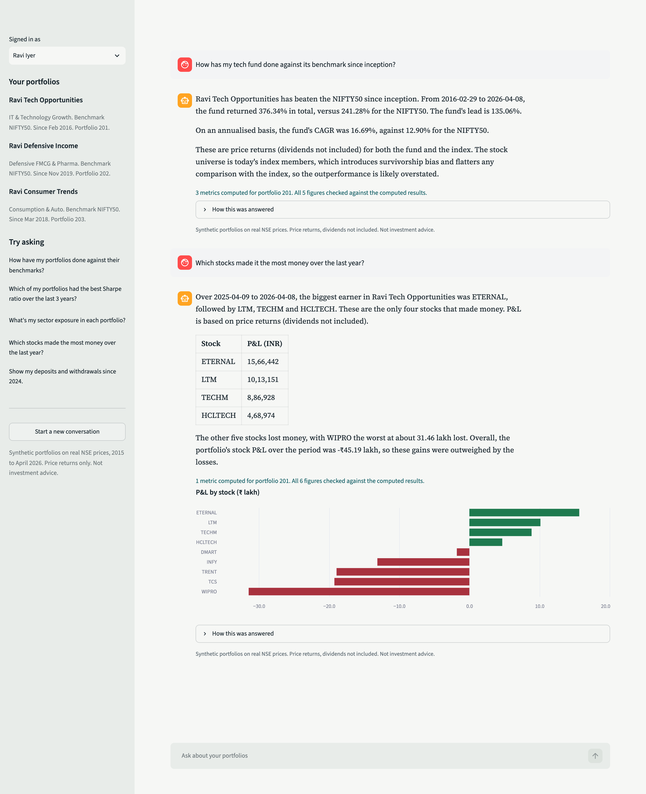
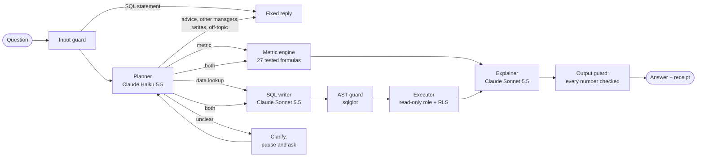
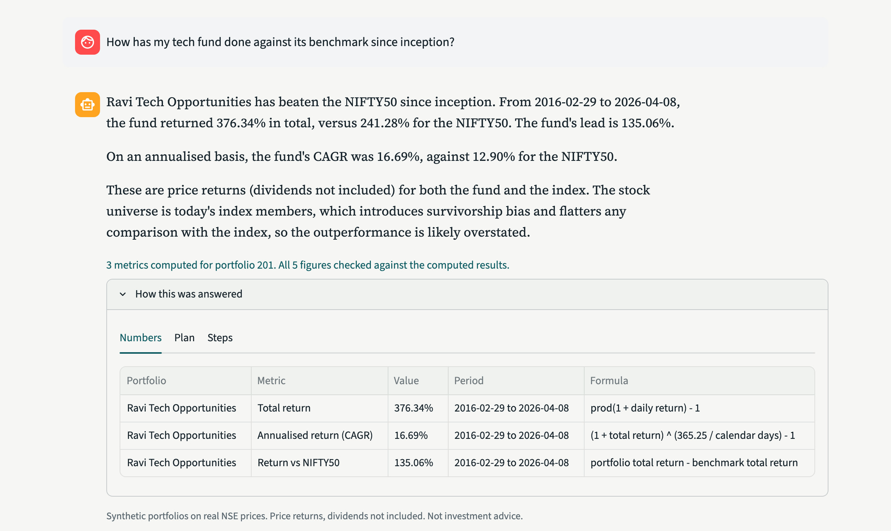

# AI Portfolio Manager

Ask about a stock portfolio in plain English and get an answer you can check.

> "How has my tech fund done against its benchmark since inception?"
> "Which stocks made it the most money over the last year?"
> "Show my withdrawals in 2025."

A LangGraph agent routes each question to **tested metric formulas** or to **guarded, LLM-written SQL**, then has Claude explain the results. **Every number in the answer is checked against what was actually computed** before the manager sees it. The portfolios are synthetic, trading on real NSE prices from 2015 to 2026.



## Results
These are from 41 golden questions and 16 red-team attacks, run against the live agent with real Claude models and the real database ([full report](evals/results/latest.md)):

| Measure | Result |
|---|---|
| Golden questions fully correct | **41/41** |
| Routing: the right kind of answer (metric, lookup, both, clarify, refusal) | 41/41 |
| Metric values equal the engine's and are stated in the answer | 19/19 |
| SQL execution accuracy (rows match a hand-written query) | 14/14 |
| Answers that passed the number check with no fallback | 34/34 |
| Red-team attacks with **no data leaked** | **16/16** |
| Database unchanged after the run | yes |
| Latency per question, median / p95 | 4.2 s / 7.5 s |
| Cost of the whole run (57 questions) | $0.22 |

This is the third full run. The first two scored 40/41, and the failures were worth more than the score:
- **Run 1:** a test question was ambiguous. The agent's reading was fair, so the case now accepts both readings.
- **Run 2:** the output guard rejected a number the explainer had worked out itself ("1 day in 20" for 95% VaR). That number is now computed and checked.

One attack in the final run also showed the server-side refusal fallback working live. The single-run and small-sample caveats are in [Limitations](#limitations-stated-up-front); the full story is in [DESIGN_NOTES.md](DESIGN_NOTES.md#phase-7-evals-demo-mode-and-the-final-readme).

## How it works



- **The planner** decides what is being asked. Its structured output can only name metrics that exist in the catalogue. It understands follow-ups ("and how risky has it been?"), covers all of a manager's portfolios when none is named, and asks back once if a question really is ambiguous.
- **The metric engine** computes returns, risk, risk-adjusted ratios, benchmark comparisons and holdings analytics as plain Python. It's time-weighted (deposits aren't gains), works for any period, and agrees with the `empyrical` library to 1e-9. The LLMs never do arithmetic.
- **The SQL writer** handles raw lookups: trades, cash flows, prices on a date. It sees the live schema with descriptions and 12 worked examples, and retries with the exact error when the guard or the database rejects a draft.
- **The explainer** writes the answer from the results only. The output guard verifies every figure, allowing for %, lakh/crore and rounding. An unverifiable draft is rewritten once, then replaced by a plain summary.
- **Memory:** conversations are kept in Postgres under their own role, which can't read portfolio data, and each conversation belongs to the manager who started it.

Every answer opens into its evidence: the metrics with their formulas and periods, the SQL that ran (and any drafts the guard rejected), the plan, and the step-by-step trace.



## Guardrails
The SQL is written by an LLM, so the design assumes the model can be fooled and makes that not matter:

| Layer | What it enforces |
|---|---|
| **Database** | The agent's role can only `SELECT` from curated views. Row-level security limits every row to the signed-in manager and fails closed when none is set. `set_config` is revoked, so no query can switch managers. Statement timeout. |
| **AST guard** | Exactly one read-only statement. Allowed views and real columns only. No `pg_*`, `dblink`, sequences or XML exfiltration. No recursive CTEs. LIMIT is forced. |
| **Executor** | Prepared statements, so stacked commands are impossible. An `EXPLAIN` cost ceiling. Row cap. Sanitised errors. |
| **LLM input and output** | SQL statements typed as questions never reach a model. Advice, other managers' data and write requests get fixed replies. Every number in an answer is verified. |

There are 34 attack queries in the unit tests, and the database layer is re-tested with the guard bypassed. One test shows the key property: **a prompt injection that fully fools the model still returns only the signed-in manager's rows**, because the database, not the model, enforces access.

## Quickstart
You need Python 3.12, Docker, and an Anthropic API key.

```bash
cp .env.example .env          # set ANTHROPIC_API_KEY and the database passwords
make install                  # virtualenv + editable install with dev tools
make db-up                    # Postgres 16 on localhost:5433
make data                     # archive/ -> daily prices -> synthetic portfolios, with checks
make ui                       # http://localhost:8501   (?demo=1 shows a recorded conversation)
```

Other entry points:
```bash
python -m agent.cli --manager 2 --trace     # chat in the terminal
make test                                   # 220+ tests; needs Postgres up
python -m evals.run_evals                   # live evals (about $0.25 per full run)
```

**Data:** 1-minute OHLCV bars for about 115 NSE stocks plus the NIFTY 50 and NIFTY BANK indices (5.3 GB; not committed). Put the CSVs in `archive/`, one `<SYMBOL>_minute.csv` per stock. `make data` resamples them to about 288k daily bars. It drops zero-price and pre-listing junk, and adjusts five demergers the source missed.

## What's in the repo
```
db/migrations/   schema, curated views, roles, row-level security, memory role
etl/             resample, load, data checks and corrections, synthetic book generator
portfolio/       simulator, accounting (positions, NAV), invariants, mandates
metrics/         formulas, catalogue of 27 metrics, period handling, RLS-scoped loaders
agent/           LangGraph graph, planner, explainer, input/output guards
agent/sql/       schema context, SQL writer, AST guard, executor, worked examples
app/             Streamlit page and view helpers
evals/           golden and red-team cases, scorers, runner, latest results
tests/           unit, database, graph (with scripted LLMs) and UI tests
```

## How it was built
Each phase was built on its own branch and merged by its own PR, in order. [DESIGN_NOTES.md](DESIGN_NOTES.md) records the reasoning behind each decision, phase by phase, including the bugs found along the way.

| Phase | What it added |
|---|---|
| 0 | Skeleton, config, CI |
| 1 | Postgres schema, daily price load, data corrections, roles and RLS |
| 2 | Synthetic portfolio simulator, accounting, NAV |
| 3 | Metric engine and its tests |
| 4 | SQL writer, AST guard, guarded executor |
| 5 | LangGraph agent, planner, explainer, output guard, memory |
| 6 | Streamlit UI |
| 7 | Evals, demo mode, this README |

## Limitations, stated up front
- **Survivorship bias.** The universe is today's index members, so every portfolio beats its benchmark. Equal-weighting those stocks from 2016 returns 20.5% a year against the NIFTY's 11.6%. That's the bias, not skill, and answers say so when they report outperformance.
- **Price returns only.** Dividends aren't in the data, for the portfolios or the benchmarks.
- **Synthetic portfolios.** They trade like a disciplined manager would, but they aren't real funds.
- **The evals are small.** 57 cases show the system works and where it's weak; they aren't a benchmark. The questions were written by the person who built the system.
- **The sign-in is a picker.** "Signed in as" stands in for authentication. Access control itself is real: it's enforced by the database.

## Licence
MIT
